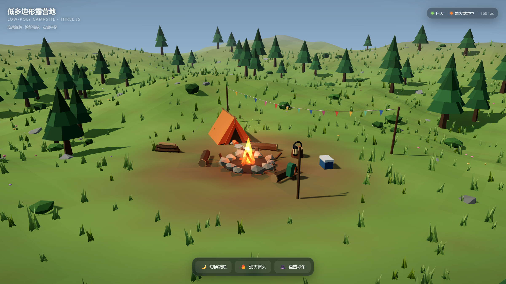
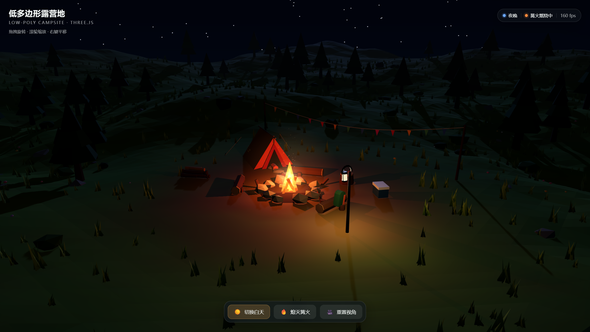

# 低多边形露营地 · Low-Poly Campsite

一个用 **Three.js** 写的低多边形风格户外露营地场景。纯前端，无后端，打开即用。




---

## 快速开始

需要 Node.js 18+（开发时使用 Node 22 验证）。

```bash
cd lowpoly-campsite
npm install

# 本地开发（带热更新）
npm run dev            # → http://127.0.0.1:5173/

# 构建
npm run build          # → dist/，同时额外生成 dist/campsite-standalone.html

# 预览构建产物（零依赖静态服务器）
npm run serve:dist     # → http://127.0.0.1:4173/
```

### 最省事的玩法：直接双击

`npm run build` 之后会额外产出一个 **`dist/campsite-standalone.html`**（约 600 KB，Three.js 已内联）。
**双击这个文件就能在浏览器里打开运行，不需要服务器、不需要联网。** 发给别人时只发这一个文件即可。

> 之所以能双击运行，是因为脚本被内联进了 HTML —— 浏览器的 `file://` 协议只禁止跨文件加载 ES 模块，不禁止内联模块。

---

## 交互

| 操作 | 方式 |
| --- | --- |
| 旋转视角 | 鼠标左键拖拽 / 单指拖拽 |
| 缩放 | 滚轮 / 双指捏合 |
| 平移 | 鼠标右键拖拽 / 双指拖拽 |
| 白天 ⇄ 夜晚 | 底部「切换夜晚 / 切换白天」按钮，或按 `N` |
| 篝火点燃 / 熄灭 | 底部「熄灭篝火 / 点燃篝火」按钮，或按 `F` |
| 回到默认机位 | 底部「重置视角」按钮，或按 `R` |

右上角实时显示当前昼夜状态、篝火状态与帧率。

---

## 场景内容

以篝火为视觉中心、向四周自然展开的营地：

- **核心区**：石圈篝火（炭化木柴 + 多层火焰 + 上升的余烬）、A 字帐篷（门帘、脊杆、张力绳、地钉、门口睡垫）、三根围火原木、靠在原木上的背包
- **生活痕迹**：柴堆、蓝色收纳箱、树桩与搪瓷杯、挂灯杆（入夜后亮起）、彩旗、踩踏出来的土路与踏脚石
- **环境**：起伏草甸 + 远景环山、118 棵低多边形松树、灌木、石头、3200 丛草、小野花
- **天空**：渐变穹顶、缓慢漂移的低多边形云，入夜后浮现 900 颗星星

### 昼夜与照明

昼夜是一条 `0 → 1` 的连续进度，沿着 **白天 → 黄昏 → 夜晚** 三段颜色轨道插值，同时驱动：
天空渐变、雾色、太阳/月亮方向与颜色、主光强度、半球光、环境光、曝光、星星透明度、挂灯亮度。

- 白天：太阳作为主光，投下清晰的树影
- 夜晚：环境整体压暗，月光转为冷色背光，篝火与挂灯成为主要光源
- **篝火是一个真实点光源（带阴影）**，夜间能清楚照亮帐篷、原木、石头和地面；熄火时火焰、余烬、地面光晕和点光源同步淡出，火塘改为升起青烟

---

## 目录结构

```
lowpoly-campsite/
├── index.html                 页面骨架 + UI 覆盖层
├── src/
│   ├── main.js                渲染器 / 相机 / 控制器 / 主循环
│   ├── style.css              UI 样式（玻璃拟态控制面板、状态条、加载遮罩）
│   ├── ui.js                  按钮绑定与状态同步
│   ├── core/
│   │   ├── noise.js           Perlin 噪声与 fbm
│   │   ├── rng.js             可复现的伪随机数
│   │   ├── math.js            插值 / 指数逼近
│   │   ├── geo.js             低多边形几何工具（岩石、草丛、帐篷、张力绳、风摆着色器）
│   │   └── lighting.js        昼夜三段插值与光源驱动
│   └── scene/
│       ├── terrain.js         地形网格、顶点着色、精确高度采样
│       ├── sky.js             天空穹顶、星星、云、日月
│       ├── vegetation.js      树木 / 灌木 / 石头 / 草丛 / 野花散布
│       ├── camp.js            帐篷与营地设施
│       └── campfire.js        篝火：火焰、点光源、余烬、烟
├── scripts/
│   ├── inline.mjs             把构建产物内联成单文件 HTML
│   └── serve.mjs              零依赖静态服务器
└── dist/                      构建产物（git 忽略）
```

---

## 实现要点

- **统一低多边形风格**：全部材质开启 `flatShading`，地形转成非索引几何体以获得硬朗面片；岩石用「位置哈希位移」保证二十面体不裂面
- **物体贴地**：地形高度函数同时用于顶点位移和物体落点，并提供基于实际三角面的重心插值采样，树木、石头、道具都不会悬空或陷地
- **性能**：树 / 灌木 / 石头 / 草 / 花全部使用 `InstancedMesh`；草木风摆走顶点着色器（`onBeforeCompile` 注入），CPU 每帧只更新一个 `uTime` uniform
- **色彩管线**：`ACESFilmicToneMapping` + sRGB 输出；火焰叠加开启色调映射，高光滚降后仍是暖色而不是死白
- **可复现**：所有随机都基于固定 seed，同一份代码每次生成完全相同的营地

实测（Chrome，视口 1440×860）：每帧 **322 draw call / 16.2 万三角面**，稳定 **160 fps**。

---

## 已验证 / 未验证

**已验证**（Chrome DevTools 实测，1440×860 与 1251×1222 两种视口）：

- `npm run dev` 与 `npm run build` 均成功；构建产物 607 KB（gzip 155 KB）
- `dist/campsite-standalone.html` 以 `file://` 直接打开可正常运行
- 控制台 **零 error、零 warning**
- 昼夜切换、篝火点燃/熄灭、视角重置按钮均生效，状态条与按钮文案同步
- 6 秒连续环绕 + 8 次昼夜/篝火切换的混合压力测试：**160 fps，无报错**
- 窗口尺寸变化时画布与相机宽高比自适应

**未验证**：Safari / Firefox / 移动端真机表现未实测（代码未使用任何 Chromium 专有 API，理论上通用）。
